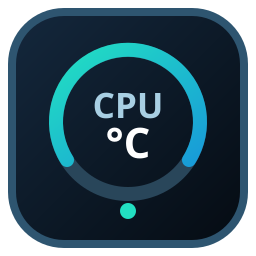
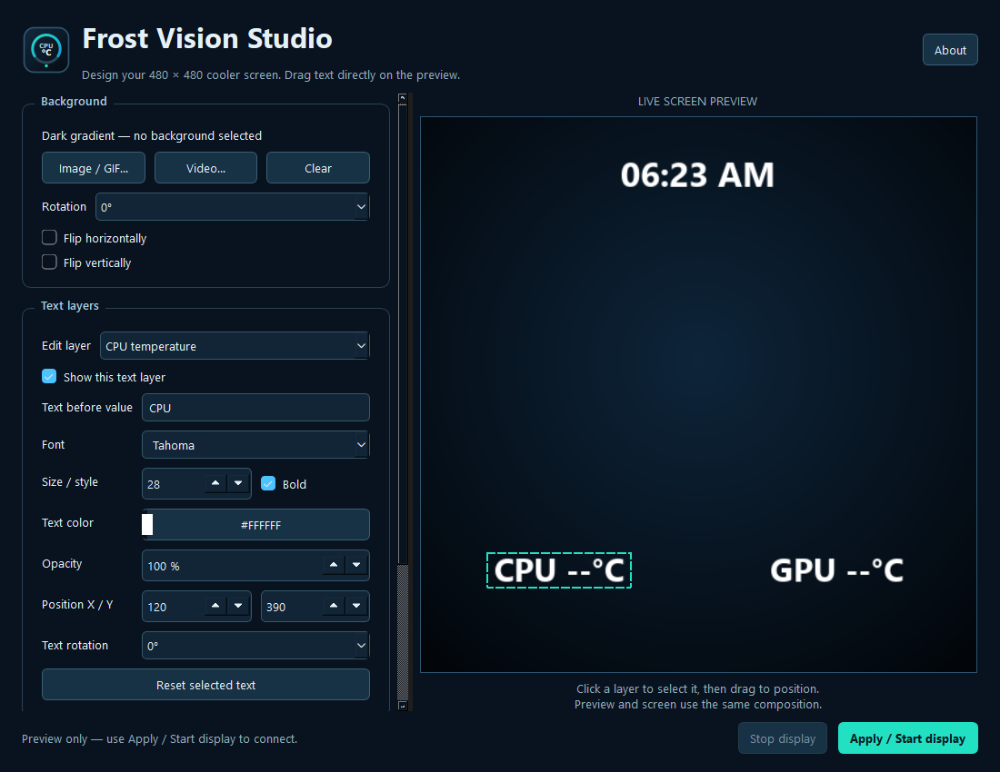

  

<h1 align="center">Frost Vision Studio</h1>

Your media. Your metrics. Your AIO display.

  
  
  

Frost Vision Studio is an independent desktop editor and direct USB renderer for the **480 × 480 Invasion Frost Vision AIO screen**. Build a display from local images, animation, video, and hardware overlays without installing or running the original screen application.

**Version 0.2.0 is a prerelease.** Windows x64 and Linux x64 are the current targets. The USB implementation is scoped to controller **`345f:9132` / `VMAXD05`**; other AIO screens, other resolutions, and macOS are future work.

## Install

Open [GitHub Releases](https://github.com/ASHRAF-2004/frost-vision-studio/releases) and choose the 0.2.0 prerelease:

| Platform | Package | Start here |
|---|---|---|
| Windows 11 x64 | Setup `.exe` | Run the installer, review the included terms, and launch Frost Vision Studio. |
| Windows 11 x64 portable | `.zip` | Extract the entire archive, then run the application inside it. |
| Linux x64 | `.tar.gz` | Extract the archive, install system USB/runtime prerequisites, then run the application. |

Read the [installation guide](docs/INSTALLATION.md) for exact steps, source setup, configuration, and troubleshooting. A working Windows installation needs compatible drivers for the panel's HID and bulk interfaces. The installer **does not install or replace USB drivers**. [Hardware support](docs/HARDWARE.md) explains that boundary.

## Make the screen yours

- Compose a live 480 × 480 preview with image, animated GIF, or looping video backgrounds.
- Place and style text overlays for available system metrics and the clock.
- Rotate or flip backgrounds and adjust overlay position, font, size, color, opacity, prefix, and rotation.
- Preview a composition before connecting to the physical screen.
- Send frames directly over USB instead of using the AIO as a desktop monitor.
- Optionally run the saved composition at login and manage that background session from the editor.
- Use a shared rendering pipeline, capped frame rate, and periodic sensor sampling to control background work.

Unavailable sensors display **`--`**. In particular, Windows CPU temperature is often unavailable through ordinary user-space APIs. The app does not invent a temperature or install a kernel sensor driver to obtain one.

## How to use

1. Launch Frost Vision Studio and choose a local background file, or keep the built-in background.
2. Enable the overlays you want, edit their style, and position them in the preview.
3. Connect the supported cooler screen by USB. Use the app's display controls to start or stop physical output.
4. Use **Stop display** to release the screen. Closing the editor stops its own display session; an existing login/background session continues until stopped.

For headless output and diagnostics, see the [CLI commands](docs/INSTALLATION.md#command-line). The editor preview can run without a connected panel; physical output requires the supported hardware and USB permissions.

## Designed to keep resource use bounded

The editor's animated output is capped at **10 frames per second**, static compositions refresh at **1 Hz**, and metrics are sampled at **1 Hz**. Media is decoded incrementally, preview and USB output share the latest rendered frame, and shutdown closes media and USB resources. A process lock prevents competing app instances from controlling the same renderer.

These are safeguards, not a promise that every media file or machine will use the same CPU or memory. Resource use still depends on codec, source resolution, sensor availability, and drivers. See [verification lanes and soak testing](docs/TESTING.md); a short test cannot establish that an app is free of memory leaks.

## Technology

| Layer | Technology | Role |
|---|---|---|
| Desktop application | Python, PySide6 / Qt | Windows and Linux editor and preview |
| Composition | Pillow | Fixed-size background transforms and text overlays |
| Media | Pillow, PyAV / FFmpeg libraries | Incremental GIF and video decoding |
| Metrics | psutil and available platform sensors | Periodic hardware readings |
| USB | hidapi, PyUSB, libusb | HID control and bulk frame transport |
| Distribution | PyInstaller, Inno Setup, GitHub Actions | Portable builds, Windows installer, release artifacts |

The [architecture map](docs/ARCHITECTURE.md) explains the selected layers and dependency paths. [Hardware notes](docs/HARDWARE.md) distinguish confirmed device enumeration from assumptions about untested panels.

## Development

See [CONTRIBUTING.md](CONTRIBUTING.md) for the development environment, [testing](docs/TESTING.md) for fast and sustained verification lanes, and the [changelog](CHANGELOG.md) for version history. Build and release instructions are in the [installation guide](docs/INSTALLATION.md#build-from-source).

## Contributing

We'd love your help with **Frost Vision Studio**! Open an issue to report a bug or suggest a feature, or send a pull request to improve the code or docs.

See [CONTRIBUTING.md](CONTRIBUTING.md) for development setup and checks, [testing](docs/TESTING.md) for verification lanes, and the [architecture map](docs/ARCHITECTURE.md) for selected layers and dependency paths.

## License and policies

Frost Vision Studio is maintained by **Ashraf Ali Hussain Al-Saloul** and distributed under the [MIT license](LICENSE). Review the [terms of use](docs/TERMS.md), [privacy information](docs/PRIVACY.md), [third-party notices](THIRD_PARTY_NOTICES.md), and [security reporting guidance](SECURITY.md).

This is an independent project. Product and company names identify compatible hardware; no manufacturer affiliation or endorsement is implied.
