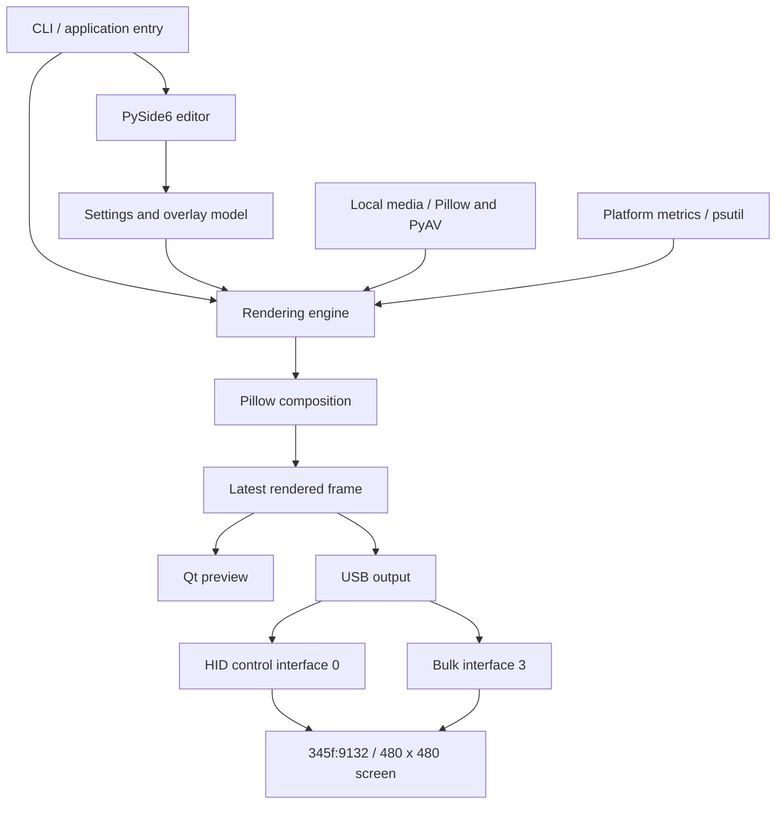

# Architecture

Frost Vision Studio composes one 480 × 480 image and makes the latest image available to the desktop preview and optional USB output. The editor remains useful without a connected panel. Sensor availability and transport details are platform-dependent; the composition format is shared.

## Selected layers and dependency paths

The diagram describes ownership and data flow. It does not imply separate operating-system processes for every box.

## Source map

| File | Selected responsibilities and dependency paths |
|---|---|
| [aio_screen_manager.py](../aio_screen_manager.py) | Compatibility launcher → application entry point |
| [frostvision/__main__.py](../frostvision/__main__.py) | CLI modes, rotating logs, Qt application lifecycle → UI/core/transport |
| [frostvision/ui.py](../frostvision/ui.py) | Manager and draggable preview; CompositionWorker → core composition, platform lock, USB transport |
| [frostvision/core.py](../frostvision/core.py) | Settings normalization/atomic save, media sources, metrics cache, fonts, Pillow composition |
| [frostvision/platform_support.py](../frostvision/platform_support.py) | OS configuration paths, renderer file lock, opt-in user startup |
| [frostvision/transport.py](../frostvision/transport.py) | Read-only detection and Vmax HID/bulk transport → hidapi/PyUSB/libusb |
| [scripts/soak.py](../scripts/soak.py) | Direct composition and optional USB resource probe → core/transport/platform lock |
| [scripts/build.py](../scripts/build.py) | Target-platform PyInstaller folder, dependency notices, build metadata, archive |

| Area | Responsibility | Dependency boundary |
|---|---|---|
| Entry point | Parse UI, renderer, diagnostic, and smoke-test modes | Selects work; diagnostics and fast tests avoid physical frame writes |
| Editor | Composition controls, preview, user-visible errors | Uses shared settings and the renderer; no per-paint sensor queries |
| Settings | Validated media/overlay preferences and persistence | Stores user choices; hardware state is not a permanent setting |
| Media | Open, incrementally decode, loop, replace, and close a background | Local files; bounded current decoding state rather than all frames retained |
| Metrics | Read supported platform sensors on a periodic cadence | Missing/unsupported values remain unavailable |
| Composition | Fit/transform background and draw overlays into a fixed panel-sized image | Pillow and current data; no direct USB access |
| Frame handoff | Retain the latest completed frame | Shared preview/output avoids an accumulating frame queue |
| Transport | Identify compatible hardware, configure it, send frames, and release interfaces | HID control plus bulk USB; platform adapters own driver/library differences |
| Lifecycle | Acquire instance lock and release resources on exit or error | Decoder, file, timer, worker, and USB handles have explicit owners |

## Timing and resource ownership

- Animated editor compositions are limited to 10 fps. Slow work does not authorize an ever-growing frame backlog.
- Static compositions refresh at 1 Hz so clocks and metrics can change without running an animation loop.
- Sensor sampling uses a 1 Hz cadence independent of UI painting.
- Preview and USB output consume the latest available composed frame.
- Media replacement closes the previous decoder. Shutdown stops workers/timers and releases the USB interfaces and instance lock owned by that session.

## Background-session control

A login or `--render` session runs separately from an editor opened later. It watches saved settings and publishes a fresh status heartbeat in the configuration directory. The editor reads that status and can write a stop request addressed to the active session's random owner token. Stale tokens are ignored; no PID-based process kill or network control server is used.

`renderer-status.json` and `renderer-control.json` are local coordination files, while the OS file lock remains the ownership boundary for physical output. Closing an editor stops its own worker/session. It does not stop a separately started background session; **Stop display** explicitly requests that action.

These controls limit specific sources of unnecessary work. Decoding a high-resolution source or exercising a driver can still be expensive; [soak verification](TESTING.md#soak-lane) measures those cases.

## Platform adapters

**Windows:** native HID access is used for the control interface. Bulk output uses PyUSB with a compatible libusb backend and interface-specific driver. The development machine already has a `libusb0` driver on interface 3. This is an observed host configuration, not a promise that a clean Windows installation has that driver.

**Linux:** HID/USB access requires appropriate device permissions and libusb system support. The USB permission rule is limited to vendor/product `345f:9132`; it does not establish compatibility with another panel.

**Sensors:** psutil supplies portable utilization readings and platform sensor data where available. Windows CPU temperature normally needs a separate compatible provider; unsupported readings stay `--`. No kernel sensor driver is installed by this project.

See [HARDWARE.md](HARDWARE.md) for the device protocol boundary and [INSTALLATION.md](INSTALLATION.md) for runtime requirements.

## Changes that need extra evidence

Changing frame size, USB identification, report contents, endpoint selection, or driver behavior needs device-specific evidence and physical-device validation. A new resolution is a transport capability change as well as a UI layout change. Changing decoding, timers, metric sampling, or worker lifetime needs a sustained resource test in addition to fast tests.

Public documentation and test fixtures must not include local absolute paths, device serials, private inventories, or proprietary screen software.
